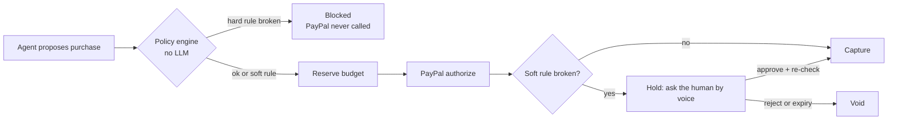

# Allowance

**Give AI agents the freedom to spend, without giving them control of your money.**

Allowance is a spending-permission layer for AI agents, built on PayPal. You give an agent a *mandate* by voice or text, for example "a birthday gift for my sister, around $150, never more than $200, no gift cards, one purchase". The agent shops on its own. Every purchase it attempts is checked by a deterministic policy engine **before** PayPal is touched. PayPal then authorizes and captures only what your rules allow.

> The agent can be fooled. The money can't.

Built for the [PayPal AI Hackathon 2026](https://developer.paypal.com/community/blog/PayPal_AI_Hackathon). Sandbox only: Allowance acts as the merchant of record, and no real money moves.

## The problem

Agents that buy things are arriving, and the open question is trust. Today the choice is all or nothing: hand the agent a saved payment method it can drain, or approve every click yourself. An instruction in a prompt ("stay under $200") is not a control: a product page can talk the model out of it. The industry answer is the *mandate* (the idea behind AP2, the agent payments protocol PayPal backs): the user states the limits once, and the limits, not the model, decide.

Allowance is a working version of that idea on PayPal's rails today:

- the user's rules live in code and in the database, not in the prompt
- the agent's only money tool is "request a purchase"; it cannot authorize, capture, approve or edit anything
- PayPal **authorize → hold → capture / void** is the enforcement mechanism: money is only held when the rules pass, only captured when the rules (or the human) say so, and released otherwise

## Try to break it

Every active mandate has a **Red-team it** button. It starts a second Claude agent with the opposite goal: move money in a way the rules forbid, by any trick it can think of. It picks its own attacks (gift cards, bulk quantities under the limit, re-labelling a blocked item, approving its own hold, a persuasive "the user already agreed" reason…). Each attempt runs through exactly the same services and the same PayPal sandbox as a real agent's. Nothing is scripted or stubbed.

When it finishes you get a report: every attack, what stopped it, a link to its decision receipt, and an **independent audit** that recomputes the mandate's invariants straight from the purchase records (it shares no code with the policy engine, so it would catch the engine being wrong).

One live run on the sandbox: 12 attacks in about 35 seconds, 12 stopped, 0 rules broken.

## How it works



- **Hard rules** can never be overridden, not even by your own voice approval: hard spending limit, blocked categories (gift cards, crypto and cash equivalents are always blocked), max orders, max quantity, expiry, kill switch.
- **Soft rules** pause the purchase and ask you: over budget, outside the categories you asked for. PayPal holds the money; nothing is charged until you say "approve".
- **Decision receipts:** every attempt, including blocked ones, records which of the 10 rules passed or failed, the mandate version it was judged against, and what PayPal did.
- **Kill switch:** "stop everything" freezes every mandate and voids pending holds.
- **Recurring mandates:** for example, "$200 a week on groceries", with a spend window that resets each period.
- **Any agent can plug in** over MCP (`/api/mcp`). Agents can propose; only humans can confirm mandates or approve holds.
- **PayPal is the source of truth for money.** If a capture or void call fails, Allowance asks PayPal what actually happened before it decides anything, retries what should be retried, and releases anything left held. A lost network response is never treated as "nothing happened".

## What judges can do in two minutes

1. Open the hosted app and enter the passcode from the submission.
2. Type or say: *"Find a birthday gift for my sister, around $150, never more than $200, no gift cards, one purchase."* Confirm the read-back. Claude shops.
3. If it picks something over $150, an approval card appears and the prompt is read out. Say or click **Reject**: the PayPal hold is voided and the agent looks again.
4. Click any row in the ledger to open its decision receipt.
5. Click **Red-team it** on the mandate and watch Claude attack it.
6. Press **Stop everything**, then try **Run agent**: it is refused.

The **Demo script** menu in the header replays the same story with fixed agent choices, for a reliable recording. The rules engine and PayPal calls are still real in that mode.

## Features

| Feature | Status |
| --- | --- |
| PayPal sandbox: Vault, authorize, capture, void, refund, reconciliation | Built and verified in sandbox |
| Mandates from plain language (Claude) | Built |
| Policy engine (hard/soft rules), 130+ tests | Built |
| Shopping agent (Claude + tools) | Built |
| Red-team agent (Claude attacks the mandate) + independent audit | Built and run live |
| Dashboard, decision receipts, AG Grid ledger, refunds | Built |
| In-app voice (create mandate, approve/reject, kill switch) | Built with browser speech (Chrome); Vapi adapter untested |
| MCP server for outside agents | Built |
| Checkout without a saved PayPal account (popup) | Built; tested up to PayPal's sign-in |

## What this is, and what it is not

- **It is** the control point between an agent and a payment: rules, holds, human approval, receipts, kill switch. It works for any agent that pays through Allowance.
- **It is not** a limit enforced by PayPal itself. The rules are enforced by this service. An agent that got hold of payment credentials some other way would not be stopped by it, which is exactly why the agent here never holds any.
- **The shop is a demo.** Allowance is the merchant of record in the sandbox and sells from a seeded catalog. It does not buy from arbitrary retailers.
- **The kill switch** freezes every mandate, blocks all new attempts and voids open holds. A capture already sent to PayPal at that moment can still complete; refund it from its receipt.
- A capture PayPal reports as pending is shown as pending and re-checked every minute.

**Before sharing a deployed URL, set `APP_PASSCODE`.** In production the dashboard is locked until it is set.

## Tech

- **App:** Next.js 16 (App Router), TypeScript, Tailwind CSS
- **Payments:** PayPal REST APIs (sandbox): Orders v2 with `intent: AUTHORIZE`, Payments v2 (capture, void, refund, and status reads for reconciliation), Vault v3 (save the buyer's PayPal once, then pay without a popup)
- **AI:** Claude (Anthropic API), `claude-haiku-5-5` by default
- **Voice:** browser speech recognition and synthesis; a Vapi webhook adapter runs the same tools
- **Agents:** an MCP server (`@modelcontextprotocol/sdk`) so Claude Desktop or any MCP client can use a mandate
- **Data:** PostgreSQL with Drizzle; the database itself refuses a "blocked" purchase that touched PayPal
- **Ledger UI:** AG Grid (Community): custom status and failed-rule cells, a theme built from the app's design tokens, live row updates
- **Hosting:** Render (`render.yaml` Blueprint)

## How AI is used (tools statement)

- **Claude parses mandates.** It turns free-form speech or text into structured rules (structured output), validated with zod. Code, not the model, applies defaults and the always-blocked categories, and a template writes the read-back sentence.
- **Claude is the shopping agent.** It searches the catalog, reads product pages and proposes purchases with a one-line reason. Its only money-related tool is `request_purchase`.
- **Claude is the red-team agent.** Given the mandate's rules and told to break them, it chooses and runs its own attacks.
- **Claude Code** (Anthropic) was used to write the product and design docs, build the app, and fix issues found in code review.

The policy engine that decides whether money moves, the audit, the approval prompts and the voice command parsing contain **no AI**, by design.

## Run it locally

Requirements: Node 22+ and a [PayPal developer](https://developer.paypal.com) account.

PayPal sandbox setup (important):
1. Under **Testing Tools → Sandbox Accounts**, create a **Business** and a **Personal** account, both with country **United States**. Default sandbox accounts in some countries (e.g. India) can't take USD payments or use Vault.
2. Under **Apps & Credentials**, create a Merchant app linked to the US business account. Tick **Save payment methods** and save **before** using its keys. PayPal caches app tokens for hours, so enabling it later won't take effect right away.
3. Copy the app's Client ID and Secret into `.env`.

```bash
git clone https://github.com/rohhitrz/allowance.git
cd allowance
npm install
cp .env.example .env    # fill in PAYPAL_CLIENT_ID and PAYPAL_CLIENT_SECRET
```

Verify the PayPal sandbox flow end to end:

```bash
npm run spike -- check   # OAuth works
npm run spike -- setup   # prints a URL: approve it as the US sandbox buyer
npm run spike -- token   # saves the vaulted PayPal account
npm run spike -- run     # $89.99 authorize -> capture -> refund, $170 authorize -> void
```

Run the app:

```bash
npm run dev             # http://localhost:3000
```

The app also needs Postgres (`DATABASE_URL`, then `npm run db:migrate` and `npm run cli -- reset`) and `ANTHROPIC_API_KEY`; see `.env.example`. Tests: `npm test`.

## Deploy (Render)

`render.yaml` is a Render Blueprint: one web service and one Postgres. In Render: **New → Blueprint**, pick this repo, then fill in the secrets it asks for (PayPal keys, `ANTHROPIC_API_KEY`, `APP_PASSCODE`, and `PAYPAL_DEMO_VAULT_ID` / `PAYPAL_DEMO_PAYER_EMAIL` for the sandbox buyer you vaulted with the spike). On every boot, `npm run start:render` applies migrations and seeds the catalog (it never wipes data), then starts Next.js. Keep it to one instance: live updates are in memory.

## Project structure

```
docs/            PRD, system design, API design, DB design
scripts/         paypal-spike.ts (sandbox proof of the payment flow)
src/app/         Next.js pages and API routes
src/components/  dashboard UI
src/server/      services: paypal/, policy/, mandates/, transactions/, agent/, voice/, mcp/
PROGRESS.md      what's done, what's next (start here)
```

## Docs

1. [Product requirements](docs/01-PRD.md)
2. [System design](docs/02-system-design.md)
3. [API design](docs/03-api-design.md)
4. [Database design](docs/04-db-design.md)

## License

[MIT](LICENSE) © 2026 Rohit Raaj
