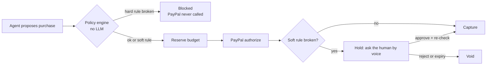

# Allowance

**Give AI agents the freedom to spend, without giving them control of your money.**

Allowance is a spending-permission layer for AI agents, built on PayPal. You give an agent a *mandate* by voice or text, for example "a birthday gift for my sister, around $150, never more than $200, no gift cards, one purchase". The agent shops on its own. Every purchase it attempts is checked by a deterministic policy engine **before** PayPal is touched. PayPal then authorizes and captures only what your rules allow.

> The agent can be fooled. The money can't.

Built for the [PayPal AI Hackathon 2026](https://developer.paypal.com/community/blog/PayPal_AI_Hackathon). Sandbox only: Allowance acts as the merchant of record, and no real money moves.

> **Status:** in active development (Nov 9–12, 2026). See [PROGRESS.md](PROGRESS.md) for what works today.

## How it works



- **Hard rules** can never be overridden, not even by your own voice approval: hard spending limit, blocked categories (gift cards, crypto and cash equivalents are always blocked), max orders, max quantity, expiry, kill switch.
- **Soft rules** pause the purchase and ask you: over budget, outside the categories you asked for.
- **Decision receipts:** every attempt, including blocked ones, records which rules passed or failed and what PayPal did.
- **Kill switch:** "stop everything" freezes every mandate and voids pending holds.
- **Recurring mandates:** for example, "$200 a week on groceries", with a spend window that resets each period.
- **Any agent can plug in** over MCP. Agents can propose; only humans can confirm mandates or approve holds.

## Features

| Feature | Status |
| --- | --- |
| PayPal sandbox client: Vault, authorize, capture, void, refund | Built, being verified |
| Mandates from plain language (Claude) | Planned |
| Policy engine (hard/soft rules) + tests | Planned |
| Shopping agent (Claude + tools) with prompt-injection demo | Planned |
| Dashboard, decision receipts, AG Grid ledger | Planned |
| In-app voice (create mandate, approve/reject, kill switch) | Planned |
| MCP server | Planned |

## Tech

- **App:** Next.js 16 (App Router), TypeScript, Tailwind CSS
- **Payments:** PayPal REST APIs (sandbox): Orders v2 with `intent: AUTHORIZE`, Payments v2 (capture, void, refund), Vault v3
- **AI:** Claude (Anthropic API). A fast model parses mandates; a stronger model runs the shopping agent with tool use
- **Voice:** Vapi, with Claude as the model
- **Data:** PostgreSQL with Drizzle
- **Ledger UI:** AG Grid (Community)
- **Hosting:** Render

## How AI is used

- **Claude parses mandates.** It turns free-form speech or text into structured rules, validated with zod and read back for confirmation.
- **Claude is the shopping agent.** It searches a catalog, reads product pages and proposes purchases with a one-line reason. It cannot move money. Its only money-related tool is `request_purchase`, which goes through the policy engine.
- **Claude drives the voice assistant**, calling the same backend tools.
- **Claude Code** (Anthropic) was used to write the product and design docs and to build the app.

The policy engine that decides whether money moves contains **no AI**, by design.

## Run it locally

Requirements: Node 22+, a [PayPal developer](https://developer.paypal.com) sandbox app (with Vault enabled), and a sandbox personal (buyer) account.

```bash
git clone https://github.com/rohhitrz/allowance.git
cd allowance
npm install
cp .env.example .env    # fill in PAYPAL_CLIENT_ID and PAYPAL_CLIENT_SECRET
```

Verify the PayPal sandbox flow end to end:

```bash
npm run spike -- check   # OAuth works
npm run spike -- setup   # prints a URL: approve it as the sandbox buyer
npm run spike -- token   # saves the vaulted PayPal account
npm run spike -- run     # $89.99 authorize -> capture -> refund, $170 authorize -> void
```

Run the app:

```bash
npm run dev             # http://localhost:3000
```

Full setup (database, Claude, voice) will be documented here as each part lands.

## Project structure

```
docs/            PRD, system design, API design, DB design
scripts/         paypal-spike.ts (sandbox proof of the payment flow)
src/app/         Next.js pages and API routes
src/server/      services: paypal/, and soon policy/, mandates/, transactions/, agent/, voice/, mcp/
PROGRESS.md      what's done, what's next (start here)
```

## Docs

1. [Product requirements](docs/01-PRD.md)
2. [System design](docs/02-system-design.md)
3. [API design](docs/03-api-design.md)
4. [Database design](docs/04-db-design.md)

## License

[MIT](LICENSE) © 2026 Rohit Raaj
