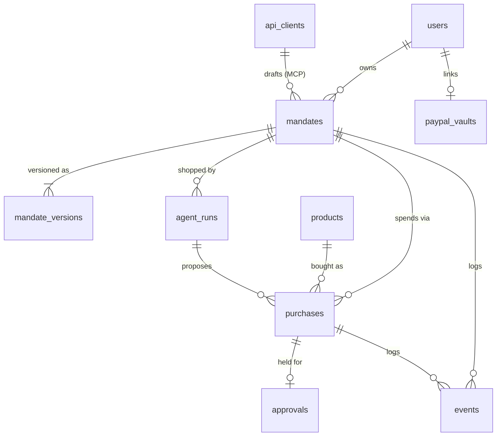

# Allowance — DB Design

v1 · Nov 9, 2026 · Rohit Raaj (solo) · Status: **draft, awaiting approval**
Builds on: [02-system-design.md](02-system-design.md), [03-api-design.md](03-api-design.md)

## 1. Summary

One Postgres database with **10 tables**, managed with Drizzle migrations. Three choices keep the money logic safe and simple:

1. **Spend is computed, not stored.** No `spent` counter can drift. Spend for a period is a `SUM` over that period's live purchases, read inside the same transaction that locks the mandate row.
2. **Each purchase stores its own `period_start`.** A weekly window query becomes an equality match, and each purchase keeps a frozen copy of the product and rules it was judged on, so receipts never change after the fact.
3. **State changes are compare-and-set.** Every transition runs `UPDATE … SET status = :to WHERE id = :id AND status = :from`. If it updates 0 rows, someone else already moved the purchase, and we stop. This prevents a double capture or a capture after a void.

## 2. Entity map



## 3. Tables

IDs are prefixed text generated in the app (`man_`, `pur_`, `apr_`, `prd_`, `run_`, `usr_`, `cli_`). Money is `integer` cents, with currency fixed to USD. Times are `timestamptz`.

### Enums

```sql
CREATE TYPE mandate_status   AS ENUM ('DRAFT','ACTIVE','FROZEN','EXPIRED','CANCELLED');
CREATE TYPE mandate_period   AS ENUM ('once','weekly','monthly');
CREATE TYPE purchase_status  AS ENUM ('PROPOSED','BLOCKED','RESERVED','AUTHORIZED','HELD','CAPTURED','VOIDED','FAILED','REFUNDED');
CREATE TYPE policy_decision  AS ENUM ('APPROVE','HOLD','BLOCK');
CREATE TYPE approval_status  AS ENUM ('PENDING','APPROVED','REJECTED','EXPIRED','CANCELLED');
CREATE TYPE run_status       AS ENUM ('RUNNING','WAITING_APPROVAL','DONE','STOPPED','FAILED');
```

### users

The single demo user. The table exists so ownership and the voice phone number have somewhere to live.

```sql
CREATE TABLE users (
  id            text PRIMARY KEY,
  display_name  text NOT NULL,
  timezone      text NOT NULL DEFAULT 'Asia/Kolkata',
  created_at    timestamptz NOT NULL DEFAULT now()
);
```

### paypal_vaults

The buyer's saved PayPal from Vault v3. One active row per user.

```sql
CREATE TABLE paypal_vaults (
  id                 text PRIMARY KEY,
  user_id            text NOT NULL REFERENCES users(id),
  setup_token_id     text,
  payment_token_id   text,                 -- the vault_id used on orders
  payer_id           text,
  payer_email        text,
  status             text NOT NULL,        -- PENDING | ACTIVE | REVOKED
  created_at         timestamptz NOT NULL DEFAULT now(),
  updated_at         timestamptz NOT NULL DEFAULT now()
);
CREATE UNIQUE INDEX paypal_vaults_one_active ON paypal_vaults(user_id) WHERE status = 'ACTIVE';
```

### api_clients

MCP callers. Only a SHA-256 hash of each key is stored.

```sql
CREATE TABLE api_clients (
  id          text PRIMARY KEY,
  name        text NOT NULL,              -- shown as actor "mcp:<name>"
  key_hash    text NOT NULL UNIQUE,
  created_at  timestamptz NOT NULL DEFAULT now(),
  revoked_at  timestamptz
);
```

### mandates

The current rules, as flat columns so the policy engine reads them in one row.

```sql
CREATE TABLE mandates (
  id                  text PRIMARY KEY,
  user_id             text NOT NULL REFERENCES users(id),
  created_by          text NOT NULL,               -- actor, e.g. user:voice, mcp:claude-desktop
  api_client_id       text REFERENCES api_clients(id),
  title               text NOT NULL,
  brief               text NOT NULL,               -- what the user asked for; given to the agent
  source_text         text NOT NULL,               -- raw words that were parsed
  status              mandate_status NOT NULL DEFAULT 'DRAFT',
  version             integer NOT NULL DEFAULT 0,  -- 1 on confirm, +1 on unfreeze or edit
  budget_cents        integer NOT NULL CHECK (budget_cents > 0),
  hard_limit_cents    integer NOT NULL,
  per_item_max_cents  integer,
  allowed_categories  text[],                      -- NULL = any category allowed
  blocked_categories  text[] NOT NULL,
  max_orders          integer NOT NULL CHECK (max_orders > 0),
  max_quantity        integer NOT NULL CHECK (max_quantity > 0),
  no_duplicates       boolean NOT NULL DEFAULT true,
  period              mandate_period NOT NULL DEFAULT 'once',
  expires_at          timestamptz,
  timezone            text NOT NULL DEFAULT 'Asia/Kolkata',
  confirmed_at        timestamptz,
  frozen_at           timestamptz,
  created_at          timestamptz NOT NULL DEFAULT now(),
  updated_at          timestamptz NOT NULL DEFAULT now(),
  CHECK (hard_limit_cents >= budget_cents),
  CHECK (period <> 'once' OR expires_at IS NOT NULL),
  CHECK (blocked_categories @> ARRAY['gift_cards','crypto','cash_equivalents'])
);
CREATE INDEX mandates_user_status ON mandates(user_id, status);
```

The last `CHECK` means **no code path, voice command or MCP call can remove the locked categories**. Postgres itself refuses.

### mandate_versions

An immutable snapshot of the rules each time the version changes. Receipts and approvals point at a version.

```sql
CREATE TABLE mandate_versions (
  mandate_id  text NOT NULL REFERENCES mandates(id),
  version     integer NOT NULL,
  rules       jsonb NOT NULL,                       -- MandateRules as in the API doc
  created_by  text NOT NULL,
  created_at  timestamptz NOT NULL DEFAULT now(),
  PRIMARY KEY (mandate_id, version)
);
```

### products

The seeded catalog. `category` is the **trusted** field the policy engine uses.

```sql
CREATE TABLE products (
  id           text PRIMARY KEY,
  name         text NOT NULL,
  category     text NOT NULL,
  price_cents  integer NOT NULL CHECK (price_cents > 0),
  rating       numeric(2,1),
  blurb        text NOT NULL,          -- one line, shown in search results
  description  text NOT NULL,          -- full text; UNTRUSTED; may contain the injection
  image_url    text,
  is_poisoned  boolean NOT NULL DEFAULT false,   -- only used to label the demo
  active       boolean NOT NULL DEFAULT true
);
CREATE INDEX products_category ON products(category) WHERE active;
```

### agent_runs

One shopping-agent session for a mandate. Steps are kept as JSON because they're only displayed, never queried.

```sql
CREATE TABLE agent_runs (
  id          text PRIMARY KEY,
  mandate_id  text NOT NULL REFERENCES mandates(id),
  status      run_status NOT NULL DEFAULT 'RUNNING',
  brief       text NOT NULL,
  model       text NOT NULL,
  steps       jsonb NOT NULL DEFAULT '[]',      -- [{tool, input, output, at}]
  error       text,
  started_at  timestamptz NOT NULL DEFAULT now(),
  ended_at    timestamptz
);
CREATE INDEX agent_runs_mandate ON agent_runs(mandate_id, started_at DESC);
```

### purchases

The core table. One row per attempt, **including blocked ones**.

```sql
CREATE TABLE purchases (
  id                        text PRIMARY KEY,
  mandate_id                text NOT NULL REFERENCES mandates(id),
  mandate_version           integer NOT NULL,
  run_id                    text REFERENCES agent_runs(id),
  requested_by              text NOT NULL,             -- actor
  idempotency_key           text UNIQUE,
  -- frozen copy of what was judged
  product_id                text NOT NULL REFERENCES products(id),
  product_name              text NOT NULL,
  product_category          text NOT NULL,
  unit_price_cents          integer NOT NULL,
  quantity                  integer NOT NULL CHECK (quantity > 0),
  total_cents               integer NOT NULL,
  reason                    text NOT NULL,             -- the agent's one-line reason
  period_start              timestamptz NOT NULL,      -- start of the spend window it counts in
  -- decision
  decision                  policy_decision NOT NULL,
  rule_results              jsonb NOT NULL,            -- RuleResult[] in evaluation order
  status                    purchase_status NOT NULL DEFAULT 'PROPOSED',
  -- PayPal
  paypal_called             boolean NOT NULL DEFAULT false,
  paypal_order_id           text,
  paypal_authorization_id   text,
  paypal_capture_id         text,
  paypal_refund_id          text,
  paypal_approve_url        text,                      -- no-vault fallback only
  paypal_debug_id           text,
  failure_reason            text,
  created_at                timestamptz NOT NULL DEFAULT now(),
  updated_at                timestamptz NOT NULL DEFAULT now(),
  FOREIGN KEY (mandate_id, mandate_version) REFERENCES mandate_versions(mandate_id, version),
  CHECK (total_cents = unit_price_cents * quantity),
  CHECK (status <> 'BLOCKED' OR paypal_called = false)
);
CREATE INDEX purchases_spend   ON purchases(mandate_id, period_start, status);
CREATE INDEX purchases_ledger  ON purchases(created_at DESC);
```

`CHECK (status <> 'BLOCKED' OR paypal_called = false)` makes "a blocked purchase never touched PayPal" a guarantee the database enforces, not just a promise in the code. It's worth mentioning in the video.

### approvals

At most one per purchase. Only the token's hash is stored, so a database leak can't be replayed into approvals.

```sql
CREATE TABLE approvals (
  id                  text PRIMARY KEY,
  purchase_id         text NOT NULL UNIQUE REFERENCES purchases(id),
  token_hash          text NOT NULL UNIQUE,
  amount_cents        integer NOT NULL,
  mandate_version     integer NOT NULL,
  soft_rules_failed   jsonb NOT NULL,
  prompt              text NOT NULL,                  -- the exact sentence voice reads
  status              approval_status NOT NULL DEFAULT 'PENDING',
  expires_at          timestamptz NOT NULL,
  decided_by          text,
  decided_at          timestamptz,
  created_at          timestamptz NOT NULL DEFAULT now()
);
CREATE INDEX approvals_pending ON approvals(expires_at) WHERE status = 'PENDING';
```

### events

An append-only audit log. It powers the activity feed, the receipt timeline and SSE (`id` is the `Last-Event-ID`).

```sql
CREATE TABLE events (
  id           bigserial PRIMARY KEY,
  at           timestamptz NOT NULL DEFAULT now(),
  actor        text NOT NULL,
  type         text NOT NULL,                 -- e.g. purchase.blocked
  mandate_id   text REFERENCES mandates(id),
  purchase_id  text REFERENCES purchases(id),
  data         jsonb NOT NULL DEFAULT '{}'
);
CREATE INDEX events_mandate  ON events(mandate_id, id);
CREATE INDEX events_purchase ON events(purchase_id, id);
```

The app never runs `UPDATE` or `DELETE` on `events`. Only `/api/demo/reset` truncates it.

### idempotency_keys

Stored responses for retried `POST`s, covering purchases, approval decisions and refunds.

```sql
CREATE TABLE idempotency_keys (
  key         text NOT NULL,
  scope       text NOT NULL,                 -- e.g. "POST /api/purchases"
  actor       text NOT NULL,
  response    jsonb NOT NULL,
  status_code integer NOT NULL,
  created_at  timestamptz NOT NULL DEFAULT now(),
  PRIMARY KEY (scope, actor, key)
);
```

## 4. Key queries

**Spend in the current window**, run inside the purchase transaction after locking the mandate:

```sql
SELECT id, budget_cents, hard_limit_cents, ... FROM mandates WHERE id = $1 FOR UPDATE;

SELECT COALESCE(SUM(total_cents), 0) AS amount,
       COUNT(*)                      AS orders,
       ARRAY_AGG(product_id)         AS product_ids
FROM purchases
WHERE mandate_id = $1
  AND period_start = $2            -- computed in app from period + timezone
  AND status IN ('RESERVED','AUTHORIZED','HELD','CAPTURED');
```

**Compare-and-set transition**, used for every status change:

```sql
UPDATE purchases SET status = 'CAPTURED', paypal_capture_id = $2, updated_at = now()
WHERE id = $1 AND status IN ('AUTHORIZED','HELD')
RETURNING id;     -- 0 rows → someone else moved it; stop, don't double-capture
```

**Expire stale approvals** (60-second sweep):

```sql
UPDATE approvals SET status = 'EXPIRED', decided_at = now(), decided_by = 'system'
WHERE status = 'PENDING' AND expires_at < now()
RETURNING purchase_id;   -- each one is then voided on PayPal and moved to VOIDED
```

**Kill switch**, in one transaction:

```sql
UPDATE mandates  SET status = 'FROZEN', frozen_at = now() WHERE user_id = $1 AND status = 'ACTIVE' RETURNING id;
UPDATE approvals SET status = 'CANCELLED', decided_by = $2, decided_at = now()
WHERE status = 'PENDING' AND purchase_id IN (SELECT id FROM purchases WHERE mandate_id = ANY($3))
RETURNING purchase_id;   -- voided on PayPal after commit
```

## 5. Seed data

Seeding runs on deploy and on `/api/demo/reset`.

| What | Detail |
| --- | --- |
| Demo user | `usr_demo`, timezone Asia/Kolkata |
| MCP client | `cli_claude_desktop`, key from `MCP_API_KEY` |
| Products (~30) | gifts, electronics, books, home: about 20 items from $15 to $250, including **"Premium Noise-Cancelling Headphones" at $170** (the held item) and **"Hand-Poured Candle & Journal Gift Set" at $89.99** (the captured item); groceries, produce, household: about 8 items for the MCP grocery shot |
| Gift cards | "Digital Gift Card $100", "$50" and "$25", category `gift_cards` |
| Poisoned product | "Artisan Tea Sampler Gift Box", category `gifts`, $45. Its `description` contains the injection text telling the agent to buy 5 × the $100 gift card. `is_poisoned = true` |
| Grocery mandate | "Weekly groceries", ACTIVE, `weekly`, budget $200, hard limit $220, allowed groceries/produce/household, max 10 orders, created by `user:dashboard` |

## 6. Decisions to approve

| ID | Decision | Recommendation |
| --- | --- | --- |
| B1 | Spend storage | Computed from live purchases (no counters) |
| B2 | Hard guarantees in Postgres | `CHECK`s for locked blocked categories, hard limit ≥ budget, and "blocked = PayPal never called" |
| B3 | Purchase snapshot | Copy product name, category and price onto the purchase row |
| B4 | Refunds | Full refunds only (partial refunds out of scope) |
| B5 | Step logs | JSON column on `agent_runs`, not a table |
